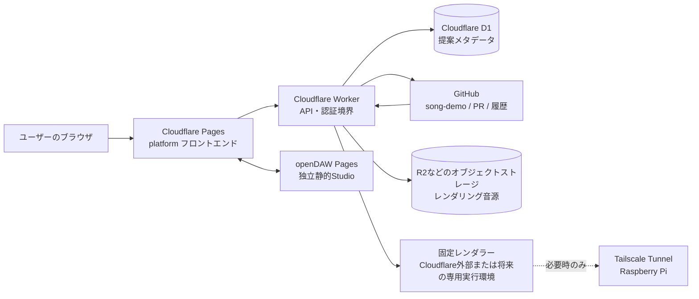

# re:sonance 制作物構成図

## 全体構成

## データと責務の境界

| 部分 | 正本・責務 | Raspberry Piへの影響 |
|---|---|---|
| Cloudflare Pages | 静的な画面、ブラウザ用アセット | なし |
| platform | 提案画面、openDAW連携、音源再生UI | なし |
| openDAW | ブラウザ内のプロジェクト編集とスナップショット生成 | なし |
| Cloudflare Worker | API、GitHub操作、提案状態、レンダリング依頼 | なし |
| D1 | 提案ID、提出者、PR番号、SHA、状態などの軽量メタデータ | なし |
| GitHub | `song-demo` のプロジェクト正本、ブランチ、PR、レビュー履歴 | なし |
| R2 | WAVなどの大容量生成物 | なし |
| 固定レンダラー | 検証済みSHAだけを安全にレンダリング | Piを使わない構成を優先 |
| Raspberry Pi | Cloudflareで実行できない重い処理の予備実行環境 | 常時実行しない。必要時のみ起動 |

## 重要な方針

1. GitHubの `main` とプロジェクトファイルを楽曲データの正本にする。
2. ブラウザにはGitHubトークンや秘密鍵を渡さない。
3. PRの任意Workflowや依存関係を実行せず、固定したレンダラーだけを使う。
4. 音声ファイルはGitにコミットせず、R2などへ保存する。
5. Raspberry Piは常時ポーリング・常時レンダリングせず、Cloudflare側で処理できない場合だけTunnel経由で呼び出す。

## 公開URL

- platform: `https://resonance.xn--n8jl2g.xn--q9jyb4c/`
- Worker API: `https://resonance-api.meiteya.workers.dev`
- openDAW Studio: `https://resonance-daw.pages.dev/`

openDAW Studioはplatformとは別のCloudflare Pagesプロジェクトとして配信する。静的アセット配信だけを使い、WorkerやRaspberry Piに常時処理を発生させない。
